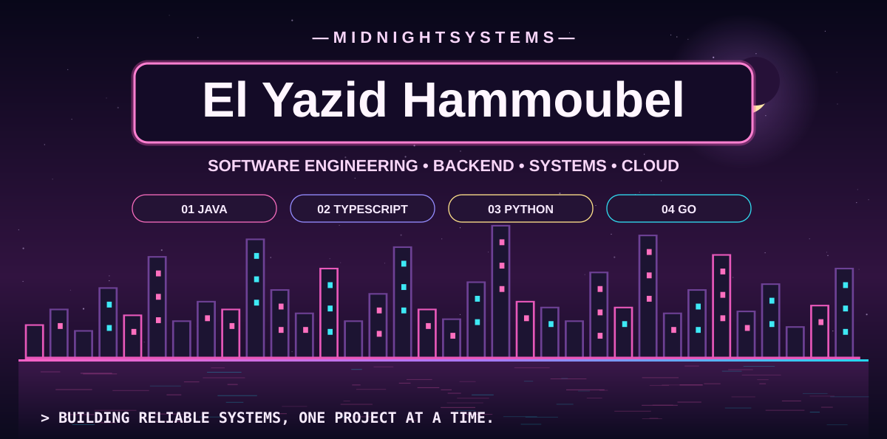
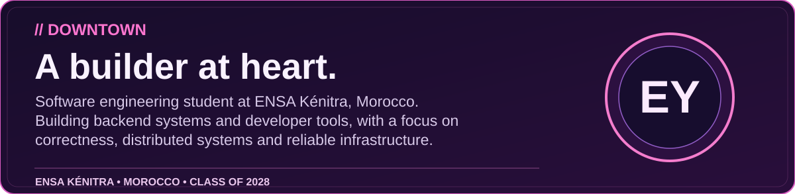
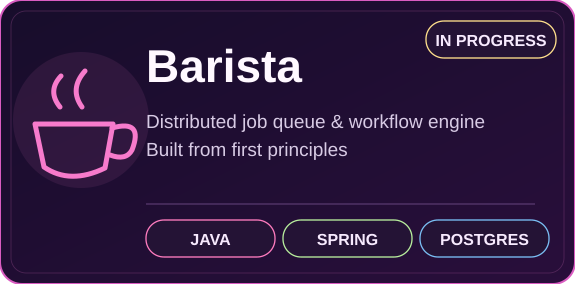
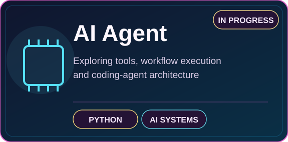
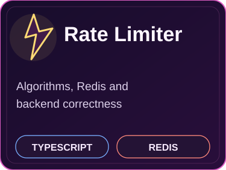
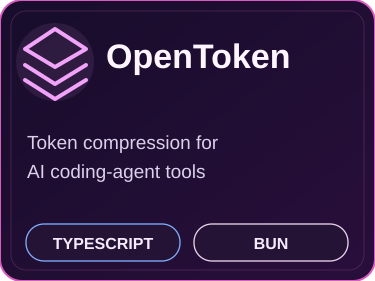
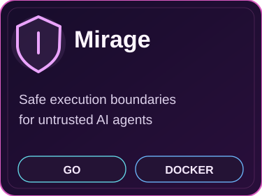
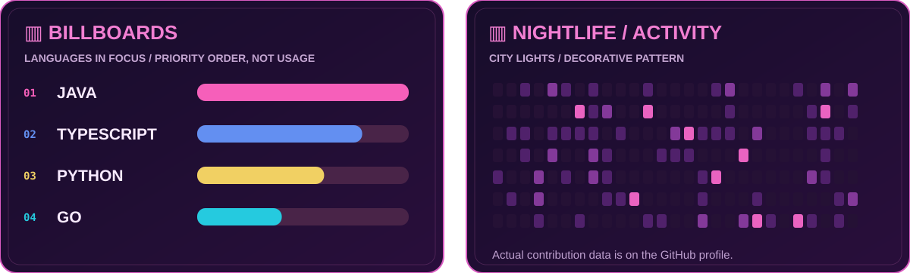
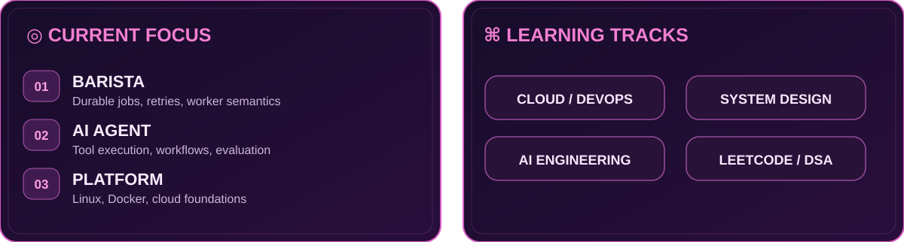

  <picture>
    <source media="(max-width: 600px)" srcset="./assets/midnight-hero-mobile.svg" />
    
  </picture>

  <a href="#projects">PROJECTS</a> &nbsp;·&nbsp; <a href="#languages">LANGUAGES</a> &nbsp;·&nbsp; <a href="#focus">CURRENT FOCUS</a> &nbsp;·&nbsp; <a href="https://github.com/MrGray17?tab=repositories">REPOSITORIES</a>

  

  

  
  

  
  
  

  
<b>Explore the engineering behind these projects</b>

  **1. [Barista](https://github.com/MrGray17/barista)** — A Java 21 / Spring Boot / PostgreSQL job queue and workflow-engine project. Work in progress: durable job storage, retry semantics, worker concurrency, transaction boundaries, and testing.

  **2. [AI Agent](https://github.com/MrGray17/AI-coding-agent-platform)** — An early-stage AI coding-agent platform learning project. Exploring tools, workflow orchestration, and evaluation. The repository is not yet a finished implementation.

  **3. [Rate Limiter](https://github.com/MrGray17/rate-limiter)** — TypeScript rate-limiting algorithms, HTTP boundaries, deterministic testing, benchmarking, and a Redis-backed implementation.

  **4. [OpenToken](https://github.com/MrGray17/opentoken)** — TypeScript/Bun tooling for compressing noisy tool output before it enters an AI coding agent's context.

  **5. [Mirage](https://github.com/MrGray17/Mirage)** — A Go-based security runtime using disposable isolated workspaces, deterministic effect verification, and narrow authorized commit boundaries.

  

  

  

  Original vector artwork inspired by a neon city skyline. No fabricated contribution counts, language percentages, or completion claims.

