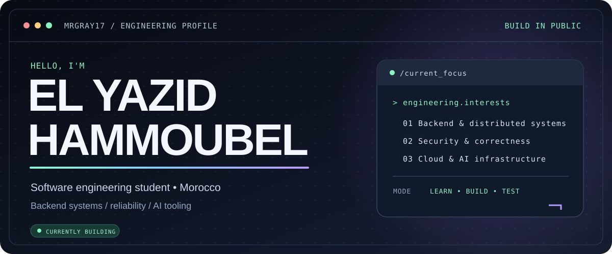
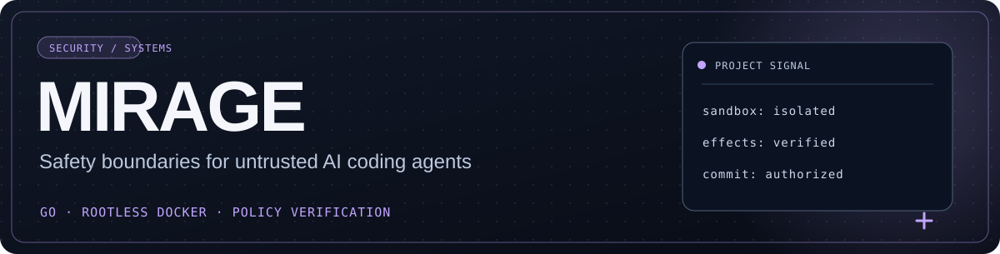
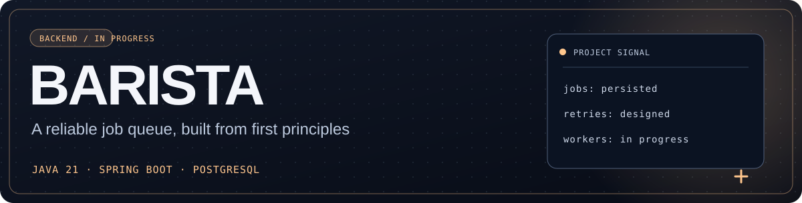

  <picture>
    <source media="(max-width: 600px)" srcset="./assets/profile-hero-mobile-v2.svg" />
    
  </picture>

  
  
  
  

## 👋 A little about me

I'm **El Yazid Hammoubel**, a software engineering student at **ENSA Kénitra, Morocco**.

I enjoy building software where the interesting problems live below the interface: **concurrency, persistence, correctness, failure recovery, and trust boundaries**. I'm especially interested in **backend and distributed systems**, with a growing focus on **cloud/platform engineering and AI infrastructure**.

> **My approach:** build something real, understand why it works, test what can break, and improve the design with evidence.

- 🔭 **Building:** Barista, a Java/Spring Boot job queue and workflow-engine project.
- 🛡️ **Exploring:** safe execution and verification of AI-generated code through Mirage.
- 🧠 **Learning:** AI engineering fundamentals, cloud/platform concepts, and deeper systems design.
- 🧰 **Working with:** Java, TypeScript, Go, Python, PostgreSQL, Docker, Linux, and Git.

## 🚀 Featured work

**[Mirage](https://github.com/MrGray17/Mirage)** — A Go-based runtime that isolates an untrusted coding agent, independently inspects its final changes, checks them against a deterministic contract, and allows only authorized effects to reach a real workspace. The project documents its security model, verification process, and limitations.

**[Barista](https://github.com/MrGray17/barista)** — An **in-progress** backend systems project built with Java 21, Spring Boot, PostgreSQL, and JDBC. I'm using it to learn durable job storage, retry semantics, concurrent workers, transactional boundaries, and testing. It's a learning-driven build, not a finished production service.

### More things I've built

<table>
  <tr>
    <td width="50%" valign="top">
      <h3>⚡ <a href="https://github.com/MrGray17/opentoken">OpenToken</a></h3>
      
A token-compression engine for AI coding-agent tool output. Focused on reducing noise before it reaches a model, with specialized output pipelines and conservative filtering.

      TypeScript · Bun · MCP · Developer tooling
    </td>
    <td width="50%" valign="top">
      <h3>🚦 <a href="https://github.com/MrGray17/rate-limiter">Rate Limiter</a></h3>
      
Rate-limiting algorithms and an HTTP service, including in-memory strategies and a Redis-backed fixed window. Built to investigate concurrency, algorithmic trade-offs, and testing.

      TypeScript · Node.js · Redis · HTTP
    </td>
  </tr>
  <tr>
    <td width="50%" valign="top">
      <h3>🩺 <a href="https://github.com/MrGray17/Maw3id">Maw3id</a></h3>
      
A developing medical-queue platform for Moroccan practices, with patient search, identity flows, and transactional queue admission. Not yet ready for real clinical use.

      React · TypeScript · Express · PostgreSQL
    </td>
    <td width="50%" valign="top">
      <h3>🪐 <a href="https://github.com/MrGray17/Launchpad">Launchpad</a></h3>
      
A local-first desktop project library built to keep repository context, active work, and next steps organized across projects.

      React · TypeScript · Tauri · Rust · SQLite
    </td>
  </tr>
</table>

## 🧩 Toolbox

  

| Using in projects | Learning more deeply |
|:--|:--|
| Java & Spring Boot, TypeScript & Node.js, PostgreSQL, Docker, REST APIs, Git | Distributed systems, cloud & platform engineering, observability, AI systems, reliability engineering |

**Engineering interests:** clear boundaries · data integrity · explicit failure handling · testability · simple architecture before unnecessary complexity.

## 🌱 Activity & experiments

  <picture>
    <source media="(prefers-color-scheme: dark)" srcset="https://raw.githubusercontent.com/MrGray17/MrGray17/output/github-contribution-grid-snake-dark.svg" />
    <source media="(prefers-color-scheme: light)" srcset="https://raw.githubusercontent.com/MrGray17/MrGray17/output/github-contribution-grid-snake.svg" />
    
  </picture>

  
🎮 Open the contribution arcade

  

---

  <b>Curious about the engineering decisions? Start with the repositories and their documentation.</b>

  <a href="https://github.com/MrGray17?tab=repositories">All repositories</a>
  &nbsp;·&nbsp;
  <a href="https://github.com/MrGray17/Mirage">Mirage</a>
  &nbsp;·&nbsp;
  <a href="https://github.com/MrGray17/barista">Barista</a>

